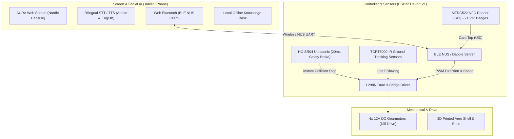

# AURA-EJUST: VIP Humanoid Robot Stack

[](https://aliahmed2206.github.io/AURA-EJUST-Robot/)
[](https://github.com/AliAhmed2206/AURA-EJUST-Robot/releases/download/v1.0.0/AURA_Humanoid_Robot_Full_Project.zip)
[](https://ejust.edu.eg/)

Comprehensive engineering repository for the **AURA-EJUST VIP Humanoid Reception & Escort Robot**, developed for the **IEEE Robotics and Automation Society (RAS)** at the **Egypt-Japan University of Science and Technology (E-JUST)**.

---

## 🌐 Permanent Live Web Links (Never Expire)

- **Production Robot Face Screen**:
  👉 **[https://aliahmed2206.github.io/AURA-EJUST-Robot/](https://aliahmed2206.github.io/AURA-EJUST-Robot/)**
  *(Run this fullscreen on any Android/iOS tablet or phone mounted on the robot's head. Uses Web Bluetooth to connect directly to the ESP32 with zero internet required).*

- **Interactive 60 FPS Face Design Lab**:
  👉 **[https://aliahmed2206.github.io/AURA-EJUST-Robot/face_lab.html](https://aliahmed2206.github.io/AURA-EJUST-Robot/face_lab.html)**
  *(Compare all 4 face concepts: Nordic Capsule, Pixar Soul, Cyber Aperture, and Japan Star Mecha).*

- **1-Click Full Project Download (ZIP)**:
  👉 **[Download AURA_Humanoid_Robot_Full_Project.zip](https://github.com/AliAhmed2206/AURA-EJUST-Robot/releases/download/v1.0.0/AURA_Humanoid_Robot_Full_Project.zip)**

---

## 📋 System Architecture



---

## 🔌 Hardware Wiring & Pinout (ESP32 DevKit V1)

### 1. L298N Dual H-Bridge Motor Driver (4 DC Motors)
| L298N Terminal | ESP32 DevKit V1 Pin | Function |
| :--- | :--- | :--- |
| **ENA** (Jumper removed) | **GPIO 25** | Left Motors PWM Speed (0–255) |
| **IN1** | **GPIO 26** | Left Motors Dir 1 |
| **IN2** | **GPIO 27** | Left Motors Dir 2 |
| **IN3** | **GPIO 14** | Right Motors Dir 1 |
| **IN4** | **GPIO 12** | Right Motors Dir 2 |
| **ENB** (Jumper removed) | **GPIO 13** | Right Motors PWM Speed (0–255) |
| **GND** | **GND** | **Common Ground** (Must connect to ESP32 GND) |
| **+12V / VMS** | **Battery + (7.4V–12V)** | Motor Power |

### 2. MFRC522 NFC Reader (Hardware VSPI)
| MFRC522 Pin | ESP32 DevKit V1 Pin | Notes |
| :--- | :--- | :--- |
| **3.3V** | **3V3** | **3.3V Only! Never connect to 5V** |
| **RST** | **GPIO 21** | Reset pin |
| **GND** | **GND** | Ground |
| **MISO** | **GPIO 19** | Master In Slave Out |
| **MOSI** | **GPIO 23** | Master Out Slave In |
| **SCK** | **GPIO 18** | SPI Clock |
| **SDA / SS** | **GPIO 5** | Chip Select |

### 3. HC-SR04 Ultrasonic Sensor & TCRT5000 IR
| Sensor | Pin | ESP32 DevKit V1 Pin | Notes |
| :--- | :--- | :--- | :--- |
| **HC-SR04** | **Trig** | **GPIO 2** | Output pulse |
| **HC-SR04** | **Echo** | **GPIO 4** | Input echo (voltage divider recommended) |
| **TCRT5000 IR** | **Left D0** | **GPIO 34** | Input only pin (Line active = LOW) |
| **TCRT5000 IR** | **Right D0** | **GPIO 35** | Input only pin |

---

## 🕹️ Firmware Options

1. **Autonomous Reception & Escort** (`Firmware/VIP_Humanoid_ESP32/VIP_Humanoid_ESP32.ino`):
   - Pre-loaded with all **21 VIP cards** (`53B80572420001` .. `53E00572420001`).
   - Welcomes VIP guests, pairs with phone screen via Web Bluetooth, and navigates along floor line.
   - Responds to bilingual voice commands.

2. **Dabble Smartphone GamePad RC** (`Firmware/AURA_Dabble_Gamepad/AURA_Dabble_Gamepad.ino`):
   - Direct driving using the **Dabble** mobile app (iOS / Android).
   - Supports both **Digital D-Pad** and fluid **Analog Joystick**.
   - Action buttons: Turbo (`Triangle`), Creep (`Circle`), Emergency Stop (`Cross`), Line Escort (`Start`).

---

## 🗣️ Directional Voice Driving Commands

| English Voice Command | Egyptian Arabic Voice Command | Action Executed |
| :--- | :--- | :--- |
| *"Move forward"* / *"Go forward"* | *"امشي لقدام"* / *"تحركي قدام"* | 1.5s forward drive pulse (with ultrasonic brake) |
| *"Move backward"* / *"Back up"* | *"ارجعي لورا"* / *"تحركي للخلف"* | 1.5s reverse drive pulse |
| *"Turn right"* / *"Spin right"* | *"حودي يمين"* / *"لفي يمين"* | 650 ms right spin pulse |
| *"Turn left"* / *"Spin left"* | *"حودي شمال"* / *"لفي شمال"* | 650 ms left spin pulse |
| *"Turn around"* / *"Rotate 180"* | *"لفي ورا"* / *"لفي 180"* | 1300 ms 180° pivot |
| *"Hard stop"* / *"Emergency stop"* | *"اقفي حالا"* / *"فرملي"* / *"ثبات"* | Instant motor cut |

---

## 📦 Repository Structure

```
AURA-EJUST-Robot/
├── CAD/
│   ├── Blueprints/               # High-res assembly blueprints
│   └── SolidWorks_Parts/         # SLDPRT & STEP universal 3D files
├── docs/                         # GitHub Pages deployment folder
│   ├── index.html                # Live Robot Screen (Nordic Capsule)
│   ├── face_lab.html             # 60 FPS Face Comparison Lab
│   └── aura_concept*.jpg         # 3D Head Studio Renders
├── Firmware/
│   ├── VIP_Humanoid_ESP32/       # Main Autonomous & Web BLE Firmware
│   └── AURA_Dabble_Gamepad/      # Dabble Mobile GamePad Firmware
├── STL_3D_Print_Files/           # Ready-to-slice 3D print STL models
├── WebApp_Screen/                # Source web app files
├── AURA_Quick_Start_Guide.md     # Hardware wiring & bring-up guide
├── Antigravity_Local_Relay_Bridge.py # PC FastAPI relay bridge
└── Start_Antigravity_Local_Relay_Bridge.bat # 1-Click bridge launcher
```

---

*Egypt-Japan University of Science and Technology (E-JUST) — IEEE RAS Student Branch*
